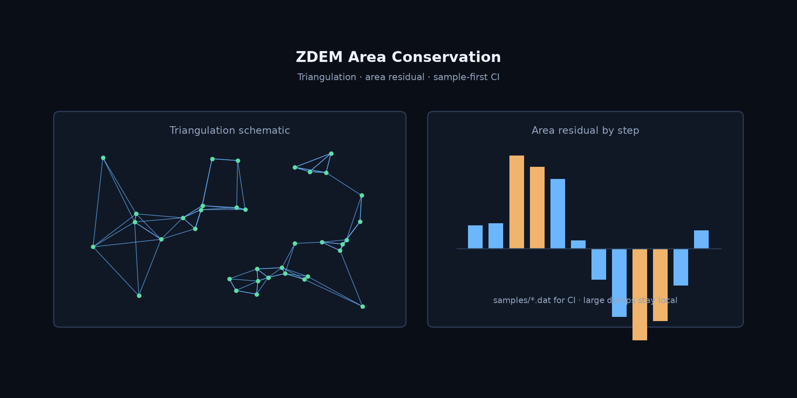

# ZDEM Area Conservation

用于二维 ZDEM 模拟颗粒子集面积估算的 Python 工具：对指定颜色颗粒进行 Delaunay 三角剖分，过滤长边三角形，并比较不同模拟帧的面积。

[English](README.md) · [许可证](LICENSE)



## 方法

程序从每个 ZDEM `.dat` 文件中提取颗粒坐标、半径和颜色编号，按颜色筛选颗粒（默认全部颜色），再进行 Delaunay 三角剖分。仅保留三条边长度均不超过 `k × 颗粒平均半径` 的三角形，并将保留三角形的面积求和；默认阈值因子 `k = 3.0`。

对于选中颗粒的中心 $p_i$ 和半径 $r_i$，记平均半径为 $\bar r$，满足每条边长均不超过 $k\bar r$ 的 Delaunay 三角形集合为 $T_k$，则估算面积为 $A_k = \sum_{t\in T_k} \operatorname{area}(t)$。该值是保留三角形的面积之和，**不是颗粒圆盘面积之和**；改变阈值或筛选颜色可能改变结果。

程序按文件名中的数字排序比较各帧面积。趋势图横轴为归一化的文件编号；百分比模式以首个有效帧面积为基准，显示相对变化。该方法是数值模拟的后处理，**不能单独作为物理实测或面积守恒已经成立的证明**；坐标单位、输入来源和参数适用性需根据具体数据确认。

## 环境与安装

需要 Python 3.10 或更高版本。运行依赖为 NumPy、SciPy 和 Matplotlib；`requirements.txt` 还包含测试用的 pytest。

```bash
python -m pip install -r requirements.txt
python Area_Conservation.py -h
```

## 数据与运行

- `samples/` 是两帧用于测试的**人工构造迷你样例**，不是实验数据，详见 [samples/README.md](samples/README.md)。
- `data/` 不纳入 Git，可保存本地模拟数据和输出；运行前请另行保留原始数据。

可先用合成样例运行（样例间距较大，需使用阈值 10）：

```bash
python Area_Conservation.py --dir=samples --output-dir=results --colors=all --threshold=10 --plot-area-type=percentage
```

对自己的数据指定 `--dir` 和新的 `--output-dir`；阈值应根据实际数据选择。

`--colors=7,8` 可筛选颜色编号，`--xmax`、`--ymax` 可调整网格图坐标范围，`--plot-area-type=raw|percentage|normalized` 可选择面积趋势显示方式。其他选项见 `python Area_Conservation.py -h`。默认绘图范围和单位标注应根据实际数据核实后再用于发表。

**输出与注意事项：**程序要求输出目录不存在，以避免覆盖；所有输出均写入该目录，包括 `particles/` 中间文件、`area_results.csv` 面积表、`run_metadata.json` 输入文件哈希及参数、面积趋势图和三角网图。读取和计算使用双精度；坐标单位尚需根据数据来源确认。运行失败时可能留下部分输出目录，请检查后另选目录重试。

## 测试与复现

```bash
python -m pytest -q tests
```

现有测试覆盖样例解析、辅助函数和基础导入，不代表已验证特定模拟的科学准确性。为便于复现，应记录源数据、模拟工况、坐标单位、筛选颜色、阈值因子、绘图设置、Python 与依赖版本，以及仓库版本（`git rev-parse HEAD`）。程序会输出面积汇总表和部分运行参数，但模拟工况、单位和仓库版本仍需研究者另行记录。完整本地模拟数据未包含在仓库中，因此仅凭合成样例不能复现基于这些数据获得的结果。

## 目录结构

| 路径 | 用途 |
| --- | --- |
| `Area_Conservation.py`、`area_geometry.py` | 分析入口与三角剖分、面积计算 |
| `zdemio.py`、`zdemplot.py` | ZDEM 数据解析和绘图辅助模块 |
| `samples/`、`tests/` | 合成样例和自动化测试 |
| `data/` | 本地模拟数据与输出，不纳入 Git |

## 引用与许可

本仓库目前没有确定的论文或引用元数据。用于研究时，请在相关论文可用后引用论文，并记录所使用的仓库版本。代码采用 [MIT 许可证](LICENSE)。
